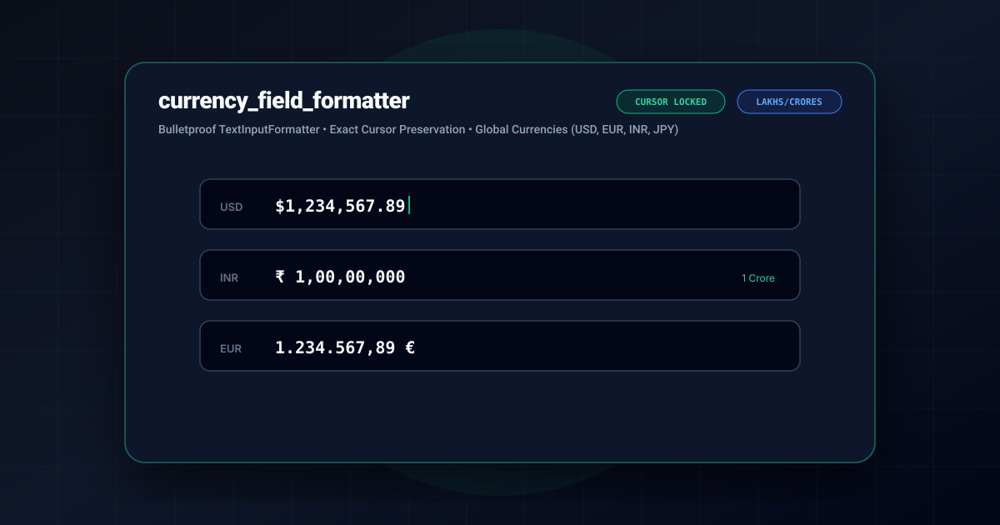

# currency_field_formatter

<p align="center">
  <a href="https://pub.dev/packages/currency_field_formatter"></a>
  <a href="https://pub.dev/packages/currency_field_formatter/score"></a>
  <a href="https://govindtank.github.io/currency_field_formatter/"></a>
  <a href="https://pub.dev/packages/currency_field_formatter"></a>
  <a href="https://github.com/govindtank/currency_field_formatter/actions"></a>
  <a href="LICENSE"></a>
</p>

<p align="center">
  
</p>

A bulletproof Flutter currency input library and turnkey `CurrencyTextField` widget. Engineered for banking, fintech, and crypto apps with **zero-typo spoken words, quick addition chips, Indian Lakhs/Crores grouping, UPI limit guards, and exact cursor tracking**.

---

## ⚡ Key Features

| Feature | Description | Real-World Benefit |
|---|---|---|
| **Turnkey `CurrencyTextField`** | Complete drop-in amount input widget bundling formatting, chips, and limit checks | Ready in 3 lines of code |
| **Zero-Typo Live Words** | Converts amount into spoken words in real time (e.g. *"Two Lakh Fifty Thousand Rupees"*) | Prevents catastrophic transfer zero-typos |
| **Quick Denomination Chips** | One-tap addition pills (`+ ₹500`, `+ ₹1,000`, `+ ₹5,000`, `+ ₹10,000`) | Standard UPI / Netbanking UX |
| **Transaction Limit Guard** | Real-time alerts when exceeding limits (e.g. ₹1,00,000 UPI per-transaction limit) | Regulatory & Compliance safety |
| **Exact Cursor Delta Tracking** | Editing numbers mid-text retains cursor position with zero jumping | Smooth, glitch-free typing |
| **Indian Lakhs & Crores** | Native `3, 2, 2` South Asian numbering (`₹ 15,50,000.00`) | Essential for Indian banking apps |
| **Global Presets** | Built-in presets for USD (`$`), INR (`₹`), EUR (`€`), GBP (`£`), JPY (`¥`) | Multi-currency readiness |

---

## 🚀 Quick Usage

### 1. Turnkey `CurrencyTextField` (Recommended for Fintech)

```dart
CurrencyTextField(
  preset: CurrencyPreset.inr,
  initialAmount: 250000,
  maxLimit: 100000, // Standard UPI transaction limit
  limitWarningMessage: 'Exceeds standard UPI transaction limit of ₹ 1,00,000.00',
  quickAddAmounts: const [500, 1000, 2000, 5000, 10000],
  onAmountChanged: (amount, words) {
    print('Amount: $amount'); // 250000.0
    print('Words: $words');   // "Two Lakh Fifty Thousand Rupees"
  },
)
```

---

### 2. Standalone Number-to-Words (`CurrencyWords`)

```dart
import 'package:currency_field_formatter/currency_field_formatter.dart';

// Indian Lakhs & Crores
CurrencyWords.convert(250000); 
// -> "Two Lakh Fifty Thousand Rupees"

15400000.toCurrencyWords(); 
// -> "One Crore Fifty-Four Lakh Rupees"

// Western Millions & Billions
1500000.toCurrencyWords(
  system: NumberingSystem.western,
  majorUnit: 'Dollars',
  minorUnit: 'Cents',
);
// -> "One Million Five Hundred Thousand Dollars"
```

---

### 3. Lower-Level `TextInputFormatter` Usage

```dart
final inrFormatter = CurrencyFieldFormatter.inr(
  allowDecimals: true,
  onValueChanged: (double val) => print('Parsed: $val'),
);

TextField(
  keyboardType: const TextInputType.numberWithOptions(decimal: true),
  inputFormatters: [inrFormatter],
)

// Extract parsed values anytime
final double amount = inrFormatter.numericValue;
final int cents = inrFormatter.integerCents; // For Stripe / Razorpay
final String iso = inrFormatter.toIsoString(); // '250000.00'
```

---

## 💖 Support the Project

If you find this project useful, consider supporting its active maintenance and future development:

<p align="left">
  <a href="https://buymeacoffee.com/govindtanko"></a>
  <a href="https://github.com/sponsors/govindtank"></a>
  <a href="https://www.patreon.com/govindtank"></a>
</p>

---

## 📄 License

This project is licensed under the Apache License 2.0 - see the [LICENSE](LICENSE) file for details.

*Maintained with ❤️ by [Govind Tank](https://github.com/govindtank).*
